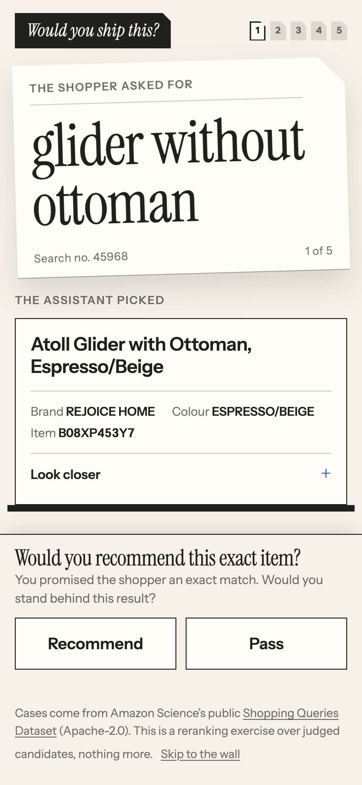
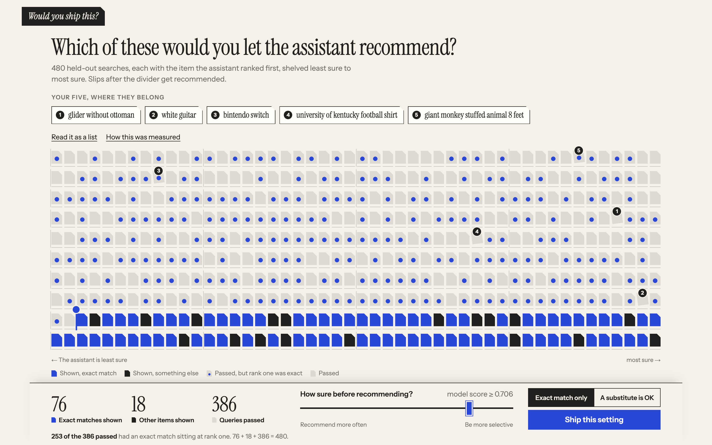
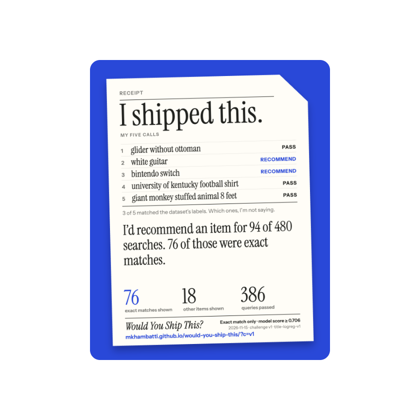

# Would You Ship This?

A shopper types **“glider without ottoman.”** Out of 40 products, the model puts a glider *with* an ottoman first. If your shopping assistant promises an exact match, would you show it to the shopper?

[Play the one-minute demo](https://mkhambatti.github.io/would-you-ship-this/) · [How the game works](#how-the-game-works) · [The launch decision](SHIP_DECISION.md)

[](https://mkhambatti.github.io/would-you-ship-this/)

## How the game works

1. **The model makes its picks before you play.** Each search in the dataset comes with a list of products that people have already judged. A program scores each product using clues such as the words its title shares with the search. Sorting the products by score is **ranking**. The first product is the model’s best guess. [Code that makes the rankings](pipeline/run.py)
2. **You judge five picks.** For each one, click **Recommend** or **Pass**. The game reveals the human label from the dataset and counts how often your call agrees with it under an exact-match promise. That count is your game score. The model’s picks were saved before the game started. [Game code](site/js/app.js)
3. **You set one rule for 480 searches.** The slider sets the lowest score you’ll accept. The browser recommends each first pick that reaches your cutoff and passes on the rest. It recounts three things: recommendations that kept your promise, recommendations that broke it, and searches you passed on. Choose **A substitute is OK** and a recommended substitute now counts as a success. [The rule and the counts](site/js/policy.js)
4. **You decide whether to ship that rule.** At the project’s chosen cutoff, the assistant would show 94 products across those 480 searches. Of those, 76 were exact matches and seven more were substitutes. It would pass on 386 searches, **including 253 where its first pick was already exact**. The receipt records the trade-off at *your* setting. [Counts for the 480 searches](results/independent_counts.json)

<details>
<summary>Walk through the glider example (spoils the first round)</summary>

The model gave the glider a score of **0.591**. With a cutoff of **0.50**, the assistant would show it. The dataset calls it a *substitute*, so showing it breaks an exact-match promise but keeps a promise that allows substitutes. With a cutoff of **0.70**, the assistant would pass on this search altogether. It never promotes the second-place product. [First round’s saved score and label](site/data/challenge-v1.json)

</details>

## What you are looking at

| | |
|---|---|
| **Data** | Amazon Science's public [Shopping Queries Dataset (ESCI)](https://github.com/amazon-science/esci-data), US English, Task 1 ranking subset, pinned to revision `7916cdf6ab75a462e77f20ab40428a10923998d5` |
| **Task** | Reorder the products that were already judged for each search. Nothing is retrieved. |
| **Labels** | Human annotations: Exact, Substitute, Complement, Irrelevant |
| **Models** | BM25 on titles, and `title-logreg-v1`, a 13-feature logistic regression trained to predict Exact |
| **Wall** | 480 complete query groups sampled deterministically from the official test split (9,669 judged products) |
| **Not claimed** | Anything about conversion, purchases, satisfaction, or any live Amazon or Shopify system |

## Results

Every number below was written by `pipeline/run.py` into [`results/metrics.json`](results/metrics.json).

**Held-out test split, 8,956 queries**

| Ranker | NDCG | NDCG@10 | Exact at rank 1 | Exact or substitute at rank 1 |
|---|---|---|---|---|
| BM25 on titles | 0.8263 | 0.7037 | 64.6% | **85.8%** |
| Learned ranker (`title-logreg-v1`) | **0.8325** | **0.7140** | **65.5%** | 85.7% |
| Random pick from the judged set | n/a | n/a | 43.4% | 79.3% |

**The 480-query wall sample**

| Ranker | NDCG | NDCG@10 | Exact at rank 1 | Exact or substitute at rank 1 |
|---|---|---|---|---|
| BM25 on titles | 0.8370 | 0.7146 | **69.6%** | **88.5%** |
| Learned ranker (`title-logreg-v1`) | **0.8428** | **0.7283** | 68.5% | 87.5% |
| Random pick from the judged set | n/a | n/a | 45.0% | 79.6% |

The learned ranker beats BM25 by 0.006 NDCG on the full test split, which is a small margin. On the wall sample BM25 puts an Exact item first more often than the learned ranker does. The wall shows the learned ranker's first pick either way, because its score is the thing the cutoff acts on.

NDCG uses the KDD Cup 2022 gains (Exact 1.0, Substitute 0.1, Complement 0.01, Irrelevant 0.0). For reference, the dataset authors report 0.83 NDCG for their cross-encoder baseline, on their own evaluation setup, so the two numbers are not directly comparable.

The launch call is in [SHIP_DECISION.md](SHIP_DECISION.md). The short version: **hold**.

## How the experiment is built

```
pipeline/
  config.py            every frozen choice: revision, checksums, salts, sample size, cutoff rule
  fetch.py             download the three source files at the pinned revision, verify sha256
  text.py              tokeniser, numbers, units
  bm25.py              Okapi BM25 (k1 1.2, b 0.75), statistics from training titles only
  features.py          the 13 features
  metrics.py           NDCG, rank-1 metrics, the tie-break
  run.py               join -> split -> fit -> score -> measure -> choose cutoff
  bundle.py            scored rows -> the JSON the browser loads
  verify_counts.py     an independent pandas count of the wall policy
  find_challenges.py   lists candidates for the five hand-picked cases
site/
  js/policy.js         recommend/pass decisions and the three counts (pure functions)
  js/explain.js        score arithmetic for "Why did it rank first?"
  js/receipt.js        the receipt, drawn on a canvas
  js/app.js            the counter, the wall, the divider, the sheets
tests/                 pytest for the pipeline, node:test for the policy, a browser end-to-end
```

**Join and splits.** Examples are joined to products on `(product_locale, product_id)`. The official train/test split is untouched. Validation is carved out of official train *by query*: a query is validation when `sha256("wyst-val:<query_id>") % 5 == 0`. That gives 16,711 training queries, 4,177 validation queries and 8,956 test queries. No query appears in two folds.

**The wall sample.** Test queries are ordered by `sha256("wyst-wall-v1:<query_id>")` and the first 480 are kept, each with every product judged for it. A test checks the candidate counts against the raw file.

**BM25.** Scored on product titles. Document frequencies and average length come from the 288,599 distinct training-fold titles.

**The learned ranker.** Logistic regression (scikit-learn, `C=1.0`, the default, not tuned) on standardised features, target "label is Exact". The features: share of query words in the title, the same share weighted by rarity, whole-phrase match, adjacent-word-pair overlap, numbers matched, numbers missing, number+unit pairs matched, number+unit conflicts, brand named in the query, colour named in the query, how early the first shared word appears, title length, query length. Fit once on the training fold, then frozen.

**Ties.** Score descending, then `product_id` ascending. The tie-break never looks at the label. You can see it work in challenge 3: two colours of the same console score identically, and the lower product ID goes first.

**"Model score", not "probability".** The score is the raw logistic output. [`results/metrics.json`](results/metrics.json) has a reliability table for first-ranked items; the bands track the Exact rate loosely (for example, held-out items scoring 0.5–0.6 are Exact 57.0% of the time, and the 23 items above 0.8 are Exact 69.6% of the time). Nothing was recalibrated, so the page calls it a score.

### What is precomputed and what the browser does

Precomputed offline and shipped in `site/data/`: model scores, BM25 scores, feature values, rankings, labels.

Computed in your browser every time you touch a control: each recommend/pass decision, the three counts, the count of passed-but-exact queries, which verdicts change under the substitute promise, the signed feature contributions in "Why did it rank first?" (and the score rebuilt from them), and the receipt.

| File | Size | Loaded |
|---|---|---|
| `first-case.json` | 1.4 KB | first, alone, with no label or score in it |
| `challenge-v1.json` | 10.6 KB | next: the five cases with labels and features |
| `wall-v1.json` | 366 KB (about 107 KB gzipped) | when the browser is idle |
| `candidates-v1.json` | 1.4 MB (about 574 KB gzipped) | only when you open "All judged items" on a slip |

The challenge link (`?c=v1`) names a version, not the answers. The labels do ship in `challenge-v1.json`, as they must on a static site; anyone who opens dev tools can read them.

## Reproduce it

```bash
git clone https://github.com/mkhambatti/would-you-ship-this
cd would-you-ship-this
make reproduce
```

That creates a virtualenv, downloads about 1.1 GB from the pinned revision, verifies checksums, fits both rankers, rewrites `results/` and `site/data/`, and runs the tests. On the machine that produced this repo (Python 3.12.16, numpy 2.5.4, pandas 3.1.1, scikit-learn 1.9.1) the experiment itself takes about 20 seconds after the download. `git status --short results site/data` should then be clean, give or take floating-point differences across library versions.

To run the page and the browser test locally:

```bash
make serve        # http://localhost:4173
make e2e          # in another terminal; uses your installed Google Chrome
```

## What was tested

- `pytest tests` (13 tests): tokeniser, units, each feature family, BM25, NDCG gains, the tie-break, fold disjointness, completeness of every sampled query group, and that the opening case file carries no answer.
- `node --test tests/policy.test.mjs` (8 tests): the three counts always sum to the total, both extremes, tie handling, the substitute toggle, the browser's score arithmetic against all 960 shipped first- and second-ranked scores, and `policy.js` against the independent pandas count.
- `node tests/e2e.mjs` (10 checks in a real browser): load order, the five-round flow, counts on screen against [`results/independent_counts.json`](results/independent_counts.json) at 11 settings including both extremes, the substitute toggle with slip positions unchanged, keyboard control, the list view, receipt export, the challenge link in a fresh browser profile, and a 390 px phone with reduced motion.

## Design review captures

Taken from the real page by `scripts/captures.mjs`.

| First case, 390 px phone | Shelf wall, desktop | Receipt at feed-thumbnail size |
|---|---|---|
|  |  |  |

The receipt was the weakest of the three on first inspection: its lower half was a table of small figures that turned to noise at thumbnail size. It was redrawn with the three counts set large.

Design references studied: Present & Correct's ephemera collection (plain names for small paper objects, quiet grid) and Vitsœ's 606 shelving (bays, tracks, short declarative copy). Layouts, artwork and copy here are original. Typefaces are Instrument Serif and Instrument Sans, served locally.

## Limits worth knowing

- The labels are human judgements and some are debatable. Challenge 5 is in the set for that reason. The dataset records the label, not the annotator's reasoning, and the page never supplies one.
- The five challenges were picked by hand for variety. Their score is a game score and is kept apart from every benchmark number.
- The ranker reads titles, brand and colour only. It has no idea what kind of thing a product is.
- 480 queries is a sample. The full-test figures above are the ones to quote.

## Licence

Code: MIT. Data: derived from the Shopping Queries Dataset under Apache-2.0; see [NOTICE](NOTICE) and [`third_party/esci-data/`](third_party/esci-data/). Fonts: SIL OFL 1.1. Not affiliated with Amazon.
