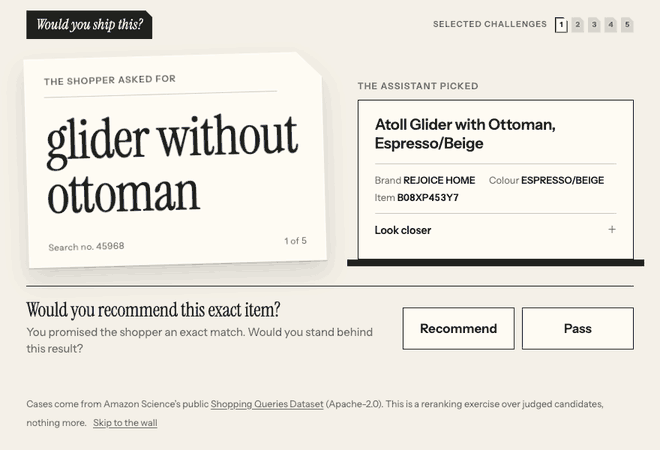

# Would You Ship This?

Someone searched for a rocking chair **without a footstool**. The top result was a chair sold **with a footstool**. A decent guess? Maybe. Good enough to recommend to someone who specifically asked for the chair on its own?

That’s the first round. You get five real shopping searches. For each one, you see what the shopper typed and the product the computer picked. Choose **Recommend** or **Pass**. The card flips over to show how a reviewer labeled it. [Play Would You Ship This?](https://mkhambatti.github.io/would-you-ship-this/)

## How the game works

The searches come from Amazon Science’s public shopping dataset. Each has a list of products and a human judgment for each product. Reviewers could say it was exactly what the shopper wanted, a reasonable substitute, something that goes with it, or something unrelated. You get a point whenever your call agrees with the reviewer under the rule “recommend exact matches.” You can disagree with a label and still see why the game scored your answer that way. [Shopping Queries Dataset](https://github.com/amazon-science/esci-data)

**Who picked the chair?** Before anyone played, a program scored the 40 products listed for that search. It had learned from other searches which clues tend to go with a good match. Do the same words show up in the title? Does the size match? Is it the brand the shopper asked for? The program put the highest scoring product first. That ordering is all *ranking* means here. The chair and footstool set came first.

<details>
<summary>Does the game use chess-style ratings?</summary>

No. In chess, Elo uses the outcome of a match and the players’ previous ratings to update their ratings. Here the products already have scores when you open the page. Clicking Recommend or Pass records your judgment for that round. The next player sees the same five cases.

</details>

## One rule for 480 searches

After the five rounds, you get a shelf of 480 searches. Now imagine you have to decide what the assistant should do for all of them, including the ones you haven’t read.

Move the slider to choose the lowest score you’ll accept. A product above that cutoff, or right on it, gets recommended. Below it, the assistant passes on the search. Watch the counts as you move it. You can see how many recommendations were exact, how many missed, and how many searches got no recommendation at all.

For example, the chair scored about 0.59. A cutoff of 0.50 would show it. A cutoff of 0.70 would hide it. The reviewer called it a substitute. If you tick **A substitute is OK**, showing that same chair now counts as keeping your promise. When you’re happy with your setting, you can save a receipt showing what you decided. [How the browser counts each choice](site/js/policy.js)

[](https://mkhambatti.github.io/would-you-ship-this/)

## Would I ship it?

I’d hold off on promising an exact match. At the cutoff I chose, the assistant recommended something for 94 of the 480 searches. It got 76 of those exactly right. What bothered me was finding **253 more exact matches among the searches it passed on**. The right item was already at the top of the list. My rule kept it from the shopper.

The game uses a sample you can look through. Across the full set of 8,956 test searches, the same rule recommended a product 1,648 times. Of those recommendations, 79.4% were exact. One mistake I’d work on next is a search for a sword that turned up a face covering with the sword’s name in the title. [The launch decision and the sword example](SHIP_DECISION.md)

## Run it yourself

To play locally, run these commands and open [localhost:4173](http://localhost:4173). The saved rankings come with the game.

```bash
git clone https://github.com/mkhambatti/would-you-ship-this
cd would-you-ship-this
python3 -m http.server 4173 --directory site
```

To recreate the rankings, run `make reproduce` from the same folder with Python, Node.js, npm and Make installed. It downloads about 1.1 GB of source data, trains the model, rebuilds the files the game reads, and runs the checks.

<details>
<summary>How the search models compare</summary>

The comparison uses a keyword search method called BM25 and a model that learns how much weight to give 13 clues from the search, title, brand and colour. On the full test set, BM25 put an exact match first 64.6% of the time. The learned model did so 65.5% of the time. The game shows the learned model’s pick.

The results also include NDCG. That measure looks at the whole list and gives more credit for putting good matches near the top. BM25 scored 0.8263 and the learned model scored 0.8325. [Model inputs](pipeline/features.py) · [Training and scoring code](pipeline/run.py) · [Full results](results/metrics.json)

</details>

## Licence

The code is licensed under MIT, the shopping data under Apache 2.0, and the fonts under the SIL Open Font License. This is an independent project. [Code licence](LICENSE) · [Data and font credits](NOTICE)
